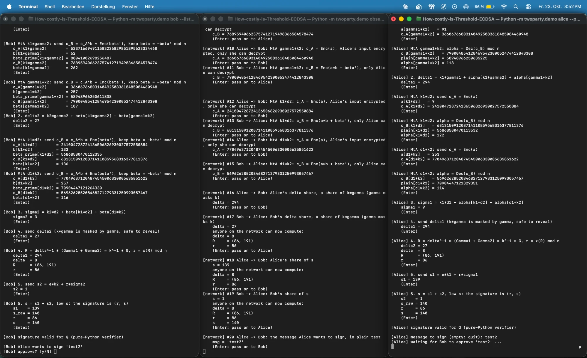

# Session 23 Oct 2026: MtA, two-party signing and a demo to watch


- **Branch:** `mta-two-party-signing`, started from Bruno's state `ce76a3b`
- **UML before/after:** [docs/uml/2026-10-23-mta-signing.md](../uml/2026-10-23-mta-signing.md)

## What this session was about

MtA with Paillier and signing in 5 steps, all in the semi-honest model (both
parties follow the protocol, so no zero-knowledge proofs). My goal for today:
understand and build MtA and signing.

## What we did (in this order)

1. **`paillier.py`**: written ourselves instead of using the `phe` library, to
   understand it, and because the visualizer will later need the values in
   between. About 50 lines: prime test, key, `encrypt`, `decrypt`, `add`,
   `mul_const`.
2. **`mta.py`**: exactly as in Katerina's email. The three steps also exist on
   their own (`alice_encrypt`, `bob_respond`, `alice_decrypt`), so they can be
   tested and shown without a network. Plus `recover_b`, the attack for the
   experiment.
3. **`protocol.py`**: setup (each party picks its own key share) and the
   5 signing steps, for Alice and for Bob.
4. **Benchmark**: `python -m twoparty --task sign` now runs between two
   processes or two devices.
5. **Demo** (`demo.py`): Alice, Bob and an observer in three terminals, one step
   per Enter. This is what I worked towards, see the picture at the end.
6. **After that**: the observer is now the hub. At the start you choose the
   mode, the pace and the experiment there. A **study mode** uses small numbers
   and shows every formula with the numbers filled in. With `--events` the
   observer writes an **event log**, a first step towards a UI.
7. **UML script** (`scripts/uml.py`): draws the code before and after a session,
   so sessions can be compared easily.

## Decisions I made today, to be confirmed with Bruno

- **Only Alice has a Paillier key.** Since `a·b = b·a`, she takes the side with
  the key in all 4 MtAs, and Bob is always the `b` side. In the paper every
  party has its own key.
- **No dealer:** each party picks its own `dᵢ` and sends `Qᵢ = dᵢ·G`, so
  `Q = Q₁ + Q₂`. The full key `d` never exists anywhere.
- **14 messages per signature, not 13:** both parties send their `sᵢ`. So both
  get the signature, and both notice when `s = 0` and they have to start again.
- **Toy curve: 58-bit Paillier key** (two 29-bit primes; Katerina wrote "~30-bit").
  That is exactly as big as needed for `N > n² + B`.
- **No range proofs.** The semi-honest model does not need them. The experiment
  is now "Bob leaves out `β'`" instead of "leave out the range proofs".

## Where things went wrong

1. **Alice stopped after 5 seconds** (`TimeoutError`). `net.connect` opened the
   socket with `timeout=5`, and in Python this holds for every later `recv`,
   not only for connecting. The benchmark never noticed, the demo did right
   away, because pressing Enter takes time. Fix: the timeout is removed after
   connecting. A test waits 6 s on purpose.
2. **The demo hung although everything was running.** Bob waited for a
   connection, Alice waited for an answer. The reason: on my Mac, **AirPlay
   (ControlCenter) uses port 5000**. It accepts every connection and never
   answers. At first we thought the timeout was the cause, but that was only
   half of it. Fix: ports 5050/5051, and the side that listens now sends a
   greeting first. If it does not arrive within 5 s, the demo stops with a
   clear message instead of hanging.
3. **Paillier is slow:** about 180 ms per encryption or decryption with
   2048 bits, so about **2.3 s per signature**. Normal ECDSA takes
   microseconds. Not optimised on purpose (with the Chinese remainder theorem,
   decryption would be 3 to 4 times faster), so the code stays easy to read.
   This is a topic for the benchmark.
4. **`k = 266` twice:** two runs gave exactly the same nonce. That looked
   suspicious, so we checked: 313,000 draws are evenly spread (chi-square 324,
   expected 312 ± 25). It was chance; on the toy curve there are only 313
   possible nonces.
5. **Counting bytes:** numbers are sent as JSON decimal text, so one Paillier
   ciphertext is about 1230 bytes instead of 512. Keep this in mind for the
   benchmark or mention it in the report.

## Why we wrote which tests

| Test | Why |
|---|---|
| Paillier example with `N = 15` (gives `173` and `11`) | Calculated by hand. If the code gives the same, the formula is right. |
| Prime test with 561, 1105, 41041 | Carmichael numbers: exactly the ones that fool a simple Fermat test. |
| `p` and `n` of secp256k1 are prime | Known, real primes to check against. |
| Random values, e.g. 1000 MtAs | This is standard: do not only test with favourite numbers. Random inputs find cases you did not think of. |
| Edge cases 0, 1, `n − 1` | This is where formulas usually break (mod, overflow, inverse of 0). |
| Largest `a·b + β'` < `N` | Otherwise it wraps around mod `N` and `α + β = a·b` is no longer true. |
| Same number encrypted twice gives different results | Otherwise you could compare ciphertexts and guess values. |
| Signature checked with **libsecp256k1** | The most important test: an independent library (the one Bitcoin uses). If it says "valid", it is real ECDSA. |
| Same signature as normal ECDSA with `d` and `k⁻¹` | Shows that the "inverted" formula `s = k·(e + r·d)` is really right. |
| Forced restart (`k₁ = 1`, `k₂ = n − 1`) | This case is rare (1/313), so we cause it on purpose. |
| 300 signatures on the toy curve | Restarts really happen there. Measured: 34 in 3000, expected about 29. |
| Counting messages (2 per MtA, 14 per signature) | This is exactly what the project measures, so the number must be right. |
| Attack without `β'` works, with `β'` it fails | The experiment has to work, and without the experiment it has to fail. |
| Waiting 6 s (timeout) and a silent port (AirPlay) | One test per bug, so they do not come back. Both failed with the old code. |
| Event log: the network sees no secrets | The demo should honestly show what someone on the network can see. |

**Status:** 130 tests pass, 1 skipped (the comparison with `phe`, which is not
installed). Before this session there were 58.

## Numbers

- secp256k1, on one laptop: setup **2.7 s** (mostly the Paillier key),
  signature **2.3 s**, about **5 KB** sent in each direction per signature.
- Per MtA: 2 messages and about 0.56 s with 2048 bits.

## Try it yourself

```bash
python -m twoparty.demo observer --listen 127.0.0.1:5050    # start this one first
python -m twoparty.demo bob      --hub    127.0.0.1:5050
python -m twoparty.demo alice    --hub    127.0.0.1:5050
```

To calculate along, use the study mode. There `β'` is only `16·n²` instead of
`n²·2⁴⁰`, so you can see for example `plain − β' = 97364 − 51864 = 45500 = 260·175 = k₁·d₂`.
That is no longer secure, but good for confirming and learning.

## Open for next time

- Do the benchmark properly: count bytes in binary instead of JSON text? Use
  libsecp256k1 for the curve points in the protocol instead of pure Python, so
  the comparison is fair?
- UI: build it on the event log (a small API in the observer and a web page).
- Visualizer: add the MtA steps (`trace.py` still lists them as "planned").

## The end of this session

My first full run: Bob on the left, the network in the middle, Alice on the
right. All three get the same signature `(r, s) = (86, 140)`, and both Alice
and Bob check it themselves as valid. The picture was taken with the first
version of the demo, before the study mode and before the observer became the
hub.


