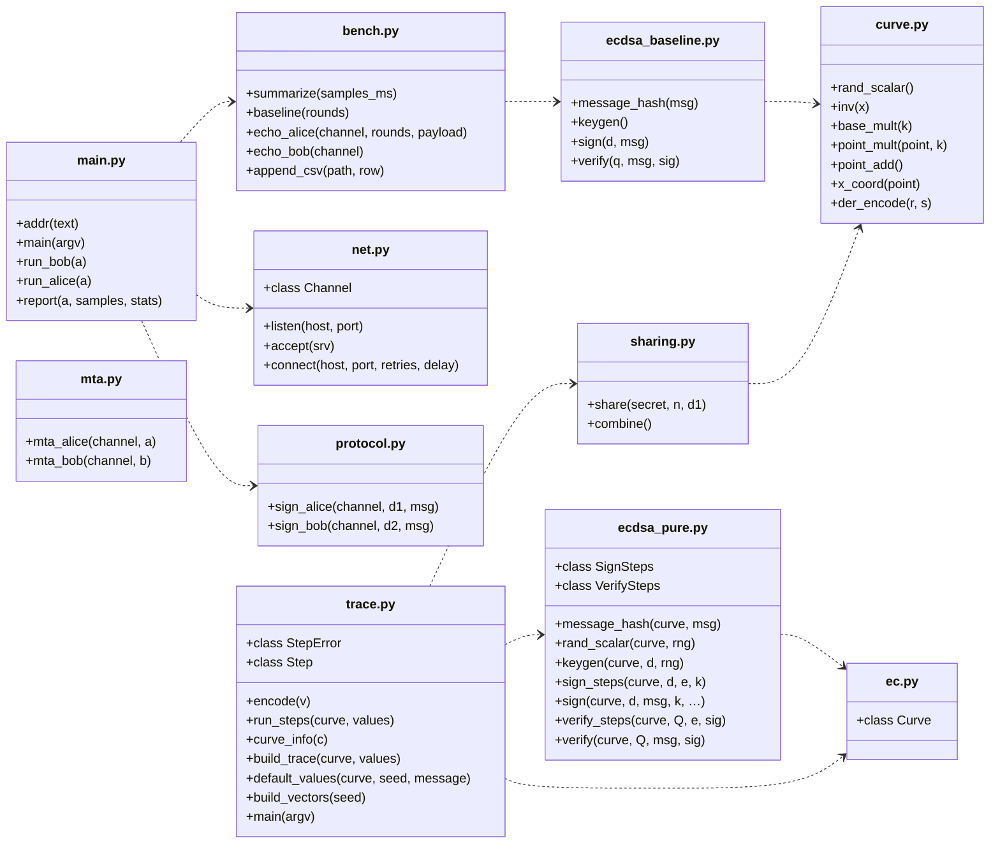
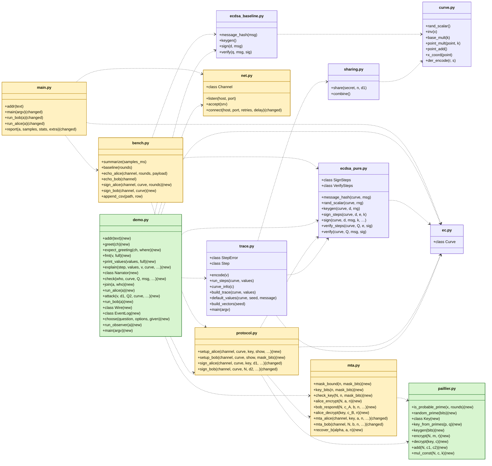

# UML: Bruno's state vs. session 23 Oct 2026 (MtA, signing, demo)

Made from the code with `python scripts/uml.py`, not drawn by hand. Each box is a module in `src/twoparty` with its public functions and classes; an arrow `A ..> B` means "A uses B". In the after picture **green = new module**, **yellow = changed module**, and single functions are marked (new) or (changed).

Tests: 46 before → 88 after (test functions, not counting parameter variants).

## What changed

| Module | before | after | what changed |
|---|---|---|---|
| `__main__.py` | 5 | 5 | changed: `main`, `run_bob`, `run_alice`, `report` |
| `bench.py` | 5 | 7 | new: `sign_alice`, `sign_bob` |
| `curve.py` | 7 | 7 | unchanged |
| `demo.py` | – | 17 | **new module** |
| `ec.py` | 1 | 1 | unchanged |
| `ecdsa_baseline.py` | 4 | 4 | unchanged |
| `ecdsa_pure.py` | 9 | 9 | unchanged |
| `mta.py` | 2 | 9 | new: `mask_bound`, `key_bits`, `check_key`, `alice_encrypt`, `bob_respond`, `alice_decrypt`, `recover_b`; changed: `mta_alice`, `mta_bob` |
| `net.py` | 4 | 4 | changed: `connect` |
| `paillier.py` | – | 9 | **new module** |
| `protocol.py` | 2 | 4 | new: `setup_alice`, `setup_bob`; changed: `sign_alice`, `sign_bob` |
| `sharing.py` | 2 | 2 | unchanged |
| `trace.py` | 9 | 9 | unchanged |

## Before (`ce76a3b`)

## After (working tree)

